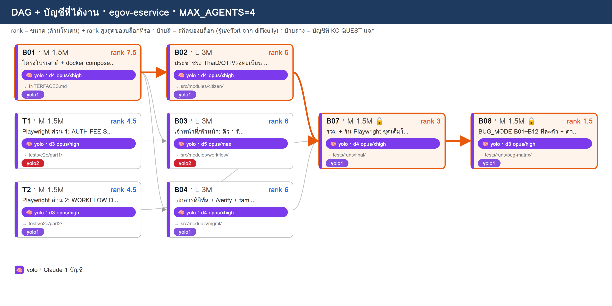
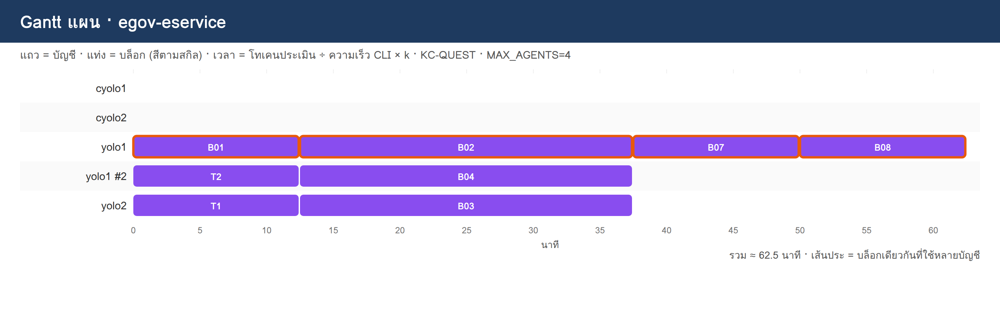
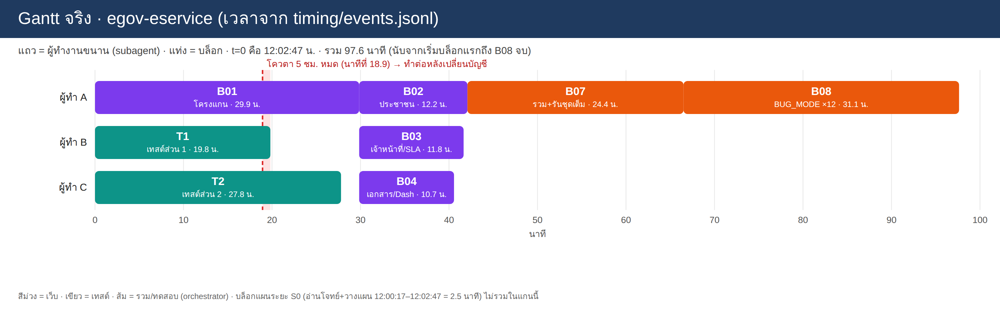
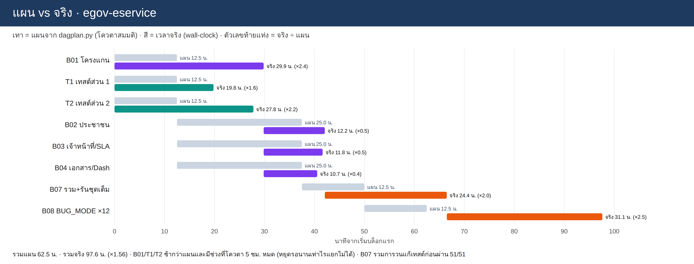
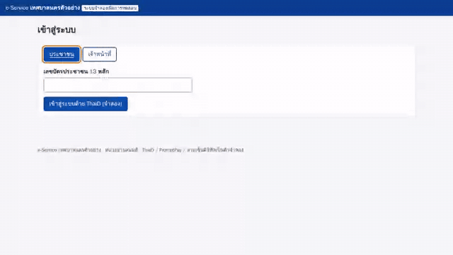
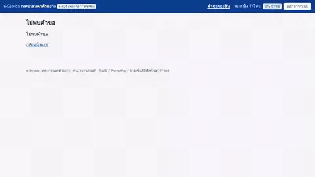

# cwn2026-week2-eservice

LAB Week 2 · e-Service กลางของ "เทศบาลนครตัวอย่าง" (สมมติ) — สร้างเว็บตามชุดโจทย์ของ TA แล้วพิสูจน์ด้วย Playwright

> **สถานะ: ครบทุกขั้นตามพรอมต์ (ข้อจำกัดอ่านที่ `REPORT.md` §1 และ §6)**
> | ขั้น | สถานะ |
> |---|---|
> | วางแผน (`blocks.json` · `PLAN.md` · `dag.png` · `gantt-plan.png`) | ✅ |
> | สร้างเว็บ (`week2/egov-eservice/app`) | ✅ |
> | Playwright 51 TC กับเว็บปกติ | ✅ 51/51 ผ่านหลายรอบ (`normal-4`, `normal-5`, `after-bughunt`, `final`) · รอบแรกๆ ล้ม 1–5 ข้อ ทุกข้อเป็น test ผิด ดู REPORT |
> | BUG_MODE B01–B12 + `BUG-HUNT.md` | ✅ จับได้ 12/12 (ล้มเกินตารางที่ยอมรับ 1 จุด: TC-NOTI-02 เมื่อเปิด B03) · ปิดบั๊กแล้วกลับมา 51/51 (`after-bughunt`) |
> | `test-report/` (results.json · index.html · GIF 47 ไฟล์) | ✅ |
> | `REPORT.md` · `gantt-actual.png` · `compare.png` · `QUESTIONS-TO-TA.md` | ✅ |

## ภาพสรุป

**แผน (DAG)** — สายวิกฤต B01 → B02 → B07 → B08 · วาดโดย `dagplan.py` ด้วยโควตาสมมติ



**Gantt: แผน vs จริง** — แผน ≈ 62.5 นาที จริง ≈ 97.6 นาที (โควตา 5 ชม. หมดกลางงาน และ B08 รัน 14 รอบ) · เวลาจริงมาจาก `timing/events.jsonl`







## ผลทดสอบ (รอบ `final`: BUG_MODE ไม่ตั้ง · ผ่าน 51/51)

| หมวด | ผ่าน |
|---|---|
| AUTH | 4/4 |
| FEE | 1/1 |
| NOTI | 2/2 |
| PAY | 4/4 |
| QUEUE | 3/3 |
| SLA | 3/3 |
| SUBMIT | 3/3 |
| UPLOAD | 2/2 |
| AUDIT | 3/3 |
| DASH | 4/4 |
| DOC | 3/3 |
| NFR | 4/4 |
| PDPA | 3/3 |
| RBAC | 6/6 |
| WORKFLOW | 6/6 |

ดูทุก TC พร้อม GIF ได้ที่ [`test-report/`](week2/egov-eservice/test-report/) (`index.html` เป็นหน้าสรุป เปิดในเครื่อง · `results.json` ดิบ · `gif/` 47 ไฟล์) — **TC ที่ไม่มี GIF 4 ข้อ** (NFR-04, PAY-02, PAY-03, PDPA-02) เป็นเทสต์ที่ตรวจ API/ไฟล์ฐานข้อมูลล้วน ไม่มีหน้าจอให้อัด

ตัวอย่าง: `TC-AUTH-01` (เลขบัตร + checksum) · `TC-SLA-01` (กำหนดเสร็จตามวันหยุด) · `TC-RBAC-01` (IDOR → 404)





## โครง

```text
week2/egov-brief/        ชุดโจทย์กลางของ TA (อ่านอย่างเดียว ที่มา: ชุดโจทย์ของคอร์ส)
week2/egov-eservice/
  blocks.json PLAN.md dag.png gantt-plan.png   แผนจาก dagplan.py (โควตาสมมติ)
  timing/events.jsonl                          เวลาเริ่ม/จบ/สะดุดจริงของแต่ละบล็อก
  app/                                         เว็บ Node 22 + Express + node:sqlite (INTERFACES.md อธิบายโครง)
  app/tests/                                   Playwright 51 TC (e2e/part1, e2e/part2) + runs/ (ผลรันจริง)
```

## รัน (ใน WSL/Linux ที่มี docker)

```bash
cd week2/egov-eservice/app
TEST_MODE=1 docker compose up --build            # เว็บที่ http://localhost:3000
TEST_MODE=1 BUG_MODE=B03,B07 docker compose up --build
bash scripts/run-suite.sh <ชื่อรอบ> [BUG_MODE]   # เว็บ + Playwright (container v1.56.1) → tests/runs/<ชื่อรอบ>/
node scripts/bug-matrix.mjs                      # B01–B12 + ชุดผสม เทียบกับ BUGS.md
```
