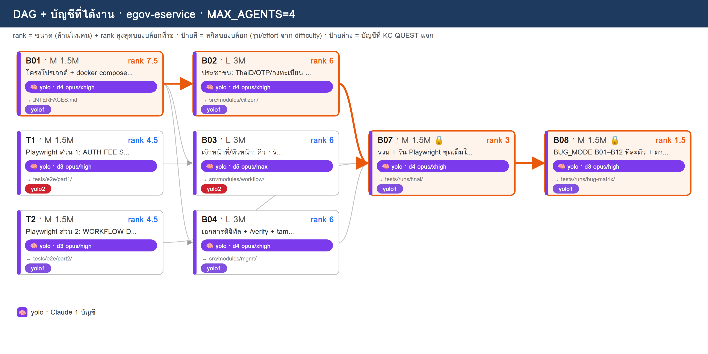
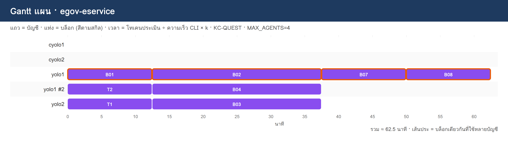

# PLAN · egov-eservice

**โจทย์:** สร้างเว็บ e-Service กลางตามชุดโจทย์ใน egov-brief (อ่าน README.md ก่อน) ต้องทำตาม REQUIREMENTS.md CONTRACT.md TEST-DATA.md DECISIONS.md ครบทุกข้อ รันด้วย Docker Compose คำสั่งเดียว รองรับ TEST_MODE=1 และ BUG_MODE ตาม BUGS.md และมีชุด Playwright ครบทุก TC ใน TEST-PLAN.md

วางแผนเมื่อ 23/11/2026 12:20 · MAX_AGENTS 4 · บัญชี cyolo1, cyolo2, yolo1, yolo2 · ตัวปรับเวลา k (ยังไม่มี calib.json → k=1)

> แผนนี้ยังไม่ได้รันจริง — KC-QUEST เลือกบัญชีจากโควตา แล้วจำลองเวลาตาม dependency

## 1) โควตาของแต่ละบัญชี

| บัญชี | แพลน | ใช้ไป 5 ชม. | ใช้ไปสัปดาห์ | headroom | รีเซ็ต/หมดอายุ (ชม.) | U | slot | ที่มา |
|---|---|---|---|---|---|---|---|---|
| cyolo1 | default | 10% | 0% | **90%** | 168.0 | 0.125 | 3 | สมมติ (--accounts) |
| cyolo2 | default | 30% | 0% | **70%** | 168.0 | 0.125 | 3 | สมมติ (--accounts) |
| yolo1 | default | 20% | 0% | **80%** | 168.0 | 0.125 | 3 | สมมติ (--accounts) |
| yolo2 | default | 40% | 0% | **60%** | 168.0 | 0.125 | 3 | สมมติ (--accounts) |

- ⚠ ทุกบัญชีเป็นค่าสมมติ (--accounts มี % ครบ) → ไม่ได้เรียก team.py check/quota

## 2) DAG + สกิล + บัญชี

**สายวิกฤต:** B01 → B02 → B07 → B08 · ยาว 7.5M tok

## 3) ตารางแจกงาน (เหตุผล KC-QUEST ทุกบล็อก)

| บล็อก | สกิล | ชื่อ | ขนาด · c | รอ | rank | บัญชี (บทบาท) | เริ่ม–จบ (นาที) | เหตุผล KC-QUEST |
|---|---|---|---|---|---|---|---|---|
| **B01** | 🧠 yolo | โครงโปรเจกต์ + docker compose + DB schema + seed + clock + test hook (reset · clock) + BUG_MODE flag | M · 1.5 | – | 7.5 | yolo1 (ทำ) | 0.0–12.5 | ทำ: yolo1 31.5 (U=0.125 F=0.005 S=0.761 S=1.0 L=0.0) · 1.50M ≈ 5ชม. 3.9% / สัปดาห์ 0.49% · อันดับ 2 yolo2 28.5 |
| T1 | 🧠 yolo | Playwright ส่วน 1: AUTH FEE SUBMIT UPLOAD PAY QUEUE SLA NOTI (22 TC) + ไฟล์ทดสอบ | M · 1.5 | – | 4.5 | yolo2 (ทำ) | 0.0–12.5 | ทำ: yolo2 22.5 (U=0.125 F=0.005 S=0.561 S=0.6 L=0.0) · 1.50M ≈ 5ชม. 3.9% / สัปดาห์ 0.49% · อันดับ 2 yolo1 21.6 |
| T2 | 🧠 yolo | Playwright ส่วน 2: WORKFLOW DOC PDPA DASH AUDIT RBAC NFR (29 TC) | M · 1.5 | – | 4.5 | yolo1 (ทำ) | 0.0–12.5 | ทำ: yolo1 21.6 (U=0.125 F=0.005 S=0.722 S=0.6 L=0.333) · 1.50M ≈ 5ชม. 3.9% / สัปดาห์ 0.49% · อันดับ 2 yolo2 18.6 |
| **B02** | 🧠 yolo | ประชาชน: ThaiD/OTP/ลงทะเบียน · SSO เจ้าหน้าที่ · ยื่นคำขอ/ร่าง · อัปโหลด · ค่าธรรมเนียม · QR ชำระ · API คำขอ (PDPA mask) | L · 3 | B01 | 6 | yolo1 (ทำ) | 12.5–37.5 | ทำ: yolo1 26.9 (U=0.125 F=0.01 S=0.644 S=0.8 L=0.0) · 3.00M ≈ 5ชม. 7.8% / สัปดาห์ 0.98% · อันดับ 2 yolo2 24.4 |
| B03 | 🧠 yolo | เจ้าหน้าที่/หัวหน้า: คิว · รับเรื่อง · ตีกลับ/ไม่อนุมัติ/อนุมัติ · 168 ชม. · ยกเลิกอัตโนมัติ · SLA วันทำการ · ระดับเตือน · แจ้งเตือน | L · 3 | B01 | 6 | yolo2 (ทำ) | 12.5–37.5 | ทำ: yolo2 24.4 (U=0.125 F=0.01 S=0.483 S=0.8 L=0.0) · 3.00M ≈ 5ชม. 7.8% / สัปดาห์ 0.98% · อันดับ 2 yolo1 22.4 |
| B04 | 🧠 yolo | เอกสารดิจิทัล + /verify + tamper · Dashboard + ส่งออก xlsx/pdf · Audit + csv + 405 · Admin · PDPA แสดงเลขเต็ม | L · 3 | B01 | 6 | yolo1 (ทำ) | 12.5–37.5 | ทำ: yolo1 22.4 (U=0.125 F=0.01 S=0.566 S=0.8 L=0.333) · 3.00M ≈ 5ชม. 7.8% / สัปดาห์ 0.98% · อันดับ 2 yolo2 19.9 |
| **B07** | 🧠 yolo | รวม + รัน Playwright ชุดเต็มใน WSL docker จนผ่าน 51/51 + test-report + GIF ของ TC P1 | M · 1.5 | B02, B03, B04, T1, T2 | 3 | yolo1 (ทำ) | 37.5–50.0 | ทำ: yolo1 19.0 (U=0.125 F=0.005 S=0.527 S=0.4 L=0.0) · 1.50M ≈ 5ชม. 3.9% / สัปดาห์ 0.49% · อันดับ 2 yolo2 17.8 |
| **B08** | 🧠 yolo | BUG_MODE B01–B12 ทีละตัว + ตาราง triage (BUG-HUNT) | M · 1.5 | B07 | 1.5 | yolo1 (ทำ) | 50.0–62.5 | ทำ: yolo1 15.4 (U=0.125 F=0.005 S=0.488 S=0.2 L=0.0) · 1.50M ≈ 5ชม. 3.9% / สัปดาห์ 0.49% · อันดับ 2 yolo2 14.8 |

## 4) Gantt แผน

## 5) รอบแจกงาน

| นาทีที่ | บล็อกที่เริ่ม |
|---|---|
| 0 | B01→yolo1, T1→yolo2, T2→yolo1 |
| 12.5 | B02→yolo1, B03→yolo2, B04→yolo1 |
| 37.5 | B07→yolo1 |
| 50 | B08→yolo1 |

## 6) สรุป

- บล็อก 8 · แจกได้ 8 · agent พร้อมกันสูงสุด 3/4
- เวลาประมาณ 62.5 นาที (แท่ง Gantt) · ไฟล์ผลของทีม: `/plans/egov-eservice/app/`

ต่อไป: `dagplan.py export egov-eservice` → `dagplan.py run egov-eservice` → `dagplan.py report egov-eservice`
